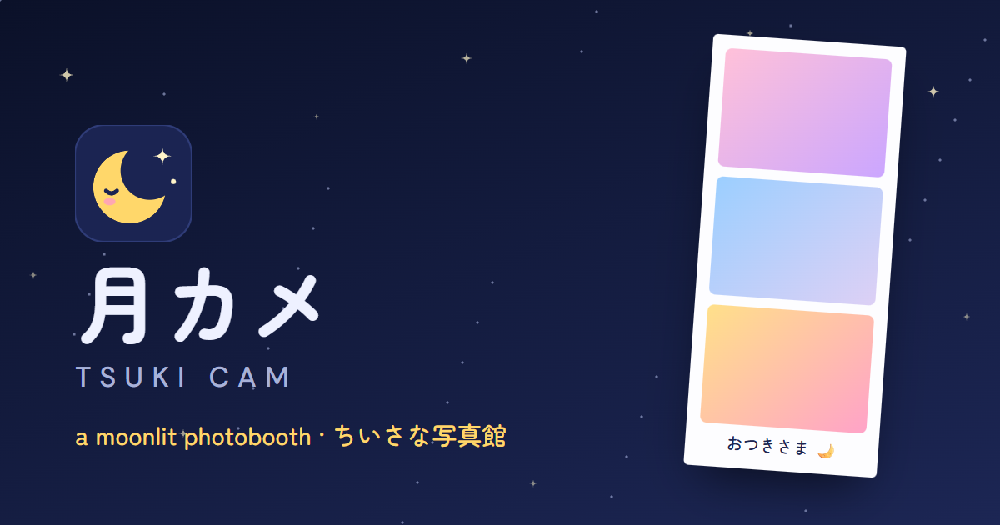

# Tsuki Cam 月カメ



A cute, moonlit photobooth that runs entirely in your browser. Snap photos with your camera (or upload them), light your face with a pastel screen glow, pick a filter, beauty level, frame and caption, and save your photo strip. Nothing is uploaded; your photos never leave your device.

**Live:** https://photo-bot-kappa.vercel.app (moving to the Tsuki Cam domain)

## Features

### Taking photos 撮る
- **Camera or upload.** Take 1–4 photos, or drag in / pick your own.
- **Self-timer.** Off, 3, 5 or 10 seconds. With a timer, Tsuki Cam counts down and fills every remaining shot automatically; you can cancel mid-way.
- **Pose ideas ポーズ.** A cute suggestion before each shot (Peace ピース, 指ハート, ねこポーズ, うさ耳…). No repeats until all 16 have been shown; can be turned off.
- **Screen light ライト.** The whole screen glows pink, lilac, blue or white to light your face, like the Xiaohongshu screen-light trick. It goes fullscreen where the browser allows; turn your brightness all the way up.
- **Front/back camera and mirror.** Switch cameras on phones and toggle mirroring. The saved photo always matches what you saw.
- **Retake.** Remove any single shot or retake them all.

### The look 見た目
- **41 filters in three groups.** They show live on the camera, as thumbnails of your own photo, and are baked into the saved strip.
  - *Tsuki 月*: soft, airy originals inspired by Japanese and Xiaohongshu photo trends: Toumei 透明, Cream, Sakura 桜, Moonlight 月光, Peach 桃, Yume 夢, Film, Showa 昭和, Neon, Matcha 抹茶.
  - *Classic*: 26 popular photo-app looks (Clarendon, Valencia, X-Pro II, Moon…) adapted from [CSSgram](https://github.com/una/CSSgram).
  - *Basic*: B&W, Sepia, Warm, Vintage, Bold.
- **Filter strength 強さ.** Fade any filter from 0–100%.
- **Beauty 美顔.** Live skin smoothing (美肌) and brightening (美白) with adjustable levels. Smoothing only touches skin tones, so eyes, hair and edges stay sharp. It also applies to saved photos, so you can change it after taking them.

### Designing the strip かざる
- **Photo shape 比率.** 3:4 portrait, 1:1 square or 4:3 landscape.
- **Layouts.** Vertical strip, horizontal strip (2–4 photos) or a 2×2 collage (4 photos).
- **Frames.** Framed (plain), Stars 星, Sakura 桜, Tsukimi 月見 (moon and susuki grass) and a glowing Full moon 満月, or no frame at all for edge-to-edge photos. The in-season frame gets a 旬 badge, and Full moon is marked 今夜だけ ("tonight only") on full-moon nights.
- **Frame colors.** Moon white, Cream, Night, Moon yellow, Sakura, Lilac, Sky, Matcha, or any custom color.
- **Caption ひとこと.** Up to 40 characters; Japanese and other scripts supported.
- **Date line with tonight's moon.** For example `13 NOV 2026 · 三日月`, with tonight's actual moon phase drawn as a little moon between the date and its Japanese name.
- **Film date stamp 日付.** The orange glowing disposable-camera date (`'26 11 13`) in the corner of each photo.
- **Big live preview.** The whole strip is shown centered and as large as fits; tap it for a full-quality view.

### Saving and the app
- **Save & share.** High-resolution PNG download, plus the native share sheet on phones (Messages, AirDrop, Instagram…).
- **Installable app.** Add Tsuki Cam to your home screen; it works offline after the first visit.
- **Starry themes.** A navy night sky (dark) and soft white with yellow stars (light). Follows your system setting and remembers your choice.
- **Works on phones.** Responsive layout, and the live camera automatically lowers its processing quality on slower devices (saved photos are always full quality).
- **Private by design.** No backend, no uploads, no accounts. Photos are kept in your browser (IndexedDB) for the current tab, so a refresh doesn't lose your strip, and old ones are cleaned up automatically.

## How it works

React 19 · Vite 7 · Tailwind CSS 4 · React Router 7 · WebGL · lucide-react

- **One renderer for preview and download.** [`src/lib/renderStrip.js`](src/lib/renderStrip.js) draws the strip on a `<canvas>`; the preview and the saved PNG use the same code, so what you see is what you get.
- **Filters.** [`src/lib/filters.js`](src/lib/filters.js) defines each filter once, as blend-mode overlays plus CSS filter functions. Live previews use CSS (`mix-blend-mode` + `filter`). Exports draw the same overlays with canvas compositing, then apply the color functions pixel by pixel (Safari doesn't support `ctx.filter`). The two match to within about 1/255.
- **Beauty.** [`src/lib/beauty.js`](src/lib/beauty.js) is a WebGL shader (skin-masked bilateral blur plus a brightening curve) that runs on every camera frame and again on each full photo at export.
- **Storage.** [`src/lib/photoStore.js`](src/lib/photoStore.js) keeps photo blobs in IndexedDB; [`src/context/PhotoSessionContext.jsx`](src/context/PhotoSessionContext.jsx) holds the session (settings and photo ids in `sessionStorage`).
- **Moon and frames.** [`src/lib/moon.js`](src/lib/moon.js) computes the moon phase; [`src/lib/frameDecor.js`](src/lib/frameDecor.js) draws the decorated frames (art stays in the margins, never over photos).
- **Options.** Layouts, shapes, frames and screen-light colors are in [`src/lib/options.js`](src/lib/options.js); theme colors are CSS variables in [`src/index.css`](src/index.css).

## Development

```bash
npm install
npm run dev       # http://localhost:5173
npm run lint
npm run build     # outputs to dist/
npm run preview   # serve the production build
```

Requires Node.js 20.19+ or 22.12+ (Vite 7). Camera access needs a secure context: `localhost` or HTTPS.

## Deploy

Deployed on Vercel with the Vite preset; no environment variables are needed.

- Set the project's Node.js version to **22.x**.
- Link-preview (Open Graph) URLs follow the project's production domain automatically via `VERCEL_PROJECT_PRODUCTION_URL`, so renaming the project only needs a redeploy. Set `SITE_URL` to override.
- [`vercel.json`](vercel.json) adds an SPA rewrite so `/capture` and `/customize` load directly, plus security headers (`Permissions-Policy` limits camera access to this site).
- The service worker (from `vite-plugin-pwa`) updates itself automatically when a new version is deployed.

## Analytics

[Vercel Web Analytics](https://vercel.com/docs/analytics) is cookie-free; turn it on in the project's **Analytics** tab. Page views are recorded on every plan. Download/share events (which filter, layout, shape and frame were used, never any photo data) are sent with `trackEvent` in [`src/lib/analytics.js`](src/lib/analytics.js), but Vercel only records custom events on the Pro plan and above.

## Roadmap

- Purikura らくがき decorating: stickers, text stamps and a doodle pen
- Studio backdrop swap (pastel or starry backgrounds), on-device
- Moving strip: a looping video/GIF of your shots
- Peace-sign ✌ hands-free shutter
- Face shaping (小顔 slim face, デカ目 big eyes)
- Event / party kiosk mode with printing

## Credits

- Classic filters adapted from [CSSgram](https://github.com/una/CSSgram) by Una Kravets (MIT).
- Film date digits use [DSEG](https://github.com/keshikan/DSEG) by keshikan (SIL OFL 1.1, see [`public/fonts/DSEG-LICENSE.txt`](public/fonts/DSEG-LICENSE.txt)).
- Fonts: [Zen Maru Gothic](https://fonts.google.com/specimen/Zen+Maru+Gothic) and [DM Sans](https://fonts.google.com/specimen/DM+Sans) via Google Fonts (SIL OFL 1.1).
- Icons: [Lucide](https://lucide.dev) (ISC).
